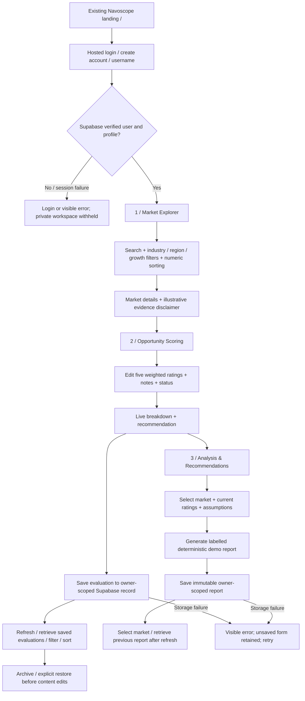

# Application flow

The persistent `NavoscopeApp` shell continues to own the video, navigation, curtain and auth dialog. Numbered route files still return null. `MarketWorkspace` renders inside the existing curtain only for a verified account/profile on pages 1–3. `/default` aliases page 1. Page 4 is unchanged. Workflow links name the actual features while the original top-level numbered buttons are preserved.

Market selection and unsaved input stay in component memory while moving between the three work pages. Leaving the workspace or refreshing discards unsaved input; saved data reloads from Supabase. Switching markets with unsaved evaluation edits asks before discarding. Reports retain the exact rating/assumption snapshot used to generate them, even when current inputs change. User changes remount the workspace using the verified account ID; logout clears the existing query cache.

The catalog is bundled, so exploration does not require a market-data API. Cloud work has loading, retry, empty, validation, success and error states. Save controls remain disabled when loading saved records fails; the application never reports a browser-local fallback as cloud persistence.

Browser unauthenticated navigation and component interactions have automated checks. Hosted signup/login, live database persistence and end-to-end authenticated browser acceptance remain manual prerequisites; see `demo-script.md` and `week7-progress.md`.

Print-friendly version: `print-diagrams.html`. The student must prepare and photograph the physical diagrams.
