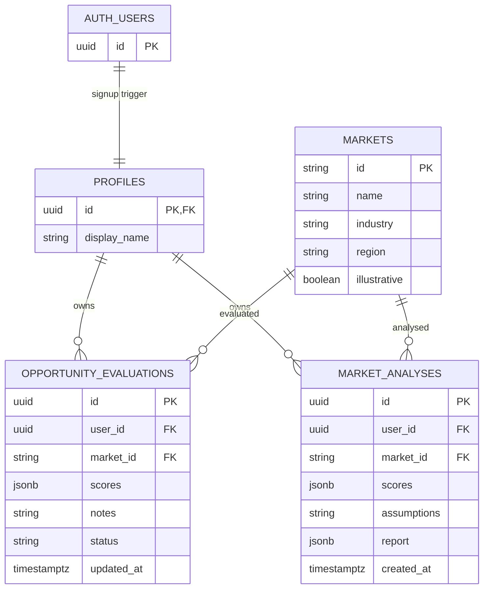

# Data model — Week 7

Implemented 29 October 2026. The existing hosted Supabase project remains the only application database. The student applied the Week 7 migration to the existing Lovable project; uploaded exports confirm all four tables with RLS enabled and a passing hosted database isolation check.

- Existing `profiles.id` references `auth.users.id`; the existing signup trigger creates the profile. No second account system was added.
- `markets` is a read-only identifier catalog. The six records match the explicitly illustrative dataset in `src/lib/market/model.ts`. Estimated figures, drivers, risks and the teaching-data disclosure live in that bundled dataset, not in a verified research database. Keep migration seeds and catalog IDs aligned when adding markets.
- Each user has at most one evaluation per market (`UNIQUE(user_id, market_id)`). Five integer ratings range from 1–5. Score is derived on read, avoiding a second stored total that could disagree with inputs.
- Analyses are immutable, user-authored rule-based snapshots with their own ratings and assumptions. Many analyses can exist per market/user. They do not reference a mutable evaluation; changing that evaluation cannot rewrite a previous report.
- There is no administrator role, role-management interface or status-history entity in the inspected schema. Do not describe these as implemented. Future administrator access needs a separately approved, server-managed role model and policies.

## Access and lifecycle

All three new tables have RLS. Authenticated users can read the catalog. Evaluation SELECT/INSERT/UPDATE checks `auth.uid() = user_id`; analyses permit only owner SELECT/INSERT. Anonymous access and client DELETE are not granted. Identity fields cannot be reassigned. A database trigger prevents modifying an archived evaluation's scores/notes, including while restoring it: first save a non-Archived status, then edit. Owner-controlled restore is intentional. Reports remain readable after archival. Database constraints validate ratings, statuses, note limits and demo report identification. Reports are not trusted provider responses or independently verified facts.

`New → Researching → Scored → Reviewed → Archived` is a suggested workflow, not a forced transition graph. Owners may change status or restore their own archived work. No deletion button or privilege elevation is provided.

## Print / physical submission

Open `docs/print-diagrams.html` in a browser and print the two pages, or draw the entity boxes and relationships on paper from this diagram. The student must arrange the two paper diagrams, photograph them and submit actual photographs. No physical task or photograph has been completed by Codex.
